# 🖥️ Windows Server 2025 | IT Support & System Administration Lab

### Building, Managing and Troubleshooting a Windows Domain Environment


**A hands-on Windows infrastructure project covering Active Directory, DNS, Group Policy, access control, user management, and real-world IT support troubleshooting.**

---

### 🧭 Explore the Project

[Overview](#-project-overview) · [Network Architecture](#-network-architecture) · [Implementation](#-what-i-built) · [Troubleshooting](#-troubleshooting--lessons-learned) · [Testing](#-testing--validation) · [Commands](#-administration-commands) · [Documentation](#-project-documentation)

---

## 📖 Project Overview

I built this project to develop practical experience with Windows Server administration and the everyday responsibilities of an IT Support Technician or Junior System Administrator.

The environment represents **AussieTech Solutions**, a fictional Australian business with multiple departments, employees, and shared IT resources.

Using Oracle VirtualBox, I deployed a Windows Server 2025 domain controller and a Windows 11 Pro workstation. I then configured Active Directory, created employee accounts, managed security groups, implemented departmental file sharing, and applied workstation security policies.

I also tested common IT support scenarios, including password resets, account lockouts, access restrictions, network connectivity problems, and DNS troubleshooting.

Rather than focusing only on installing Windows Server, I wanted to understand how these services work together and how to investigate problems when something doesn't work as expected.

### 🎯 Project at a Glance

| Component | Implementation |
|---|---|
| Organization | AussieTech Solutions (simulated) |
| Virtualization | Oracle VirtualBox |
| Server | Windows Server 2025 |
| Workstation | Windows 11 Pro |
| Domain | `corp.example.test` |
| Domain Controller | DC01 |
| Client Computer | CLIENT01 |
| Employee Accounts | 20 |
| Departments | Finance, HR, IT, Management, Operations, Sales |
| Internal Network | `192.168.50.0/24` |
| Workstation Security | 10-minute inactivity lock |
| Account Security | 5 failed attempts / 10-minute lockout |

---

## 🏗️ Network Architecture

The lab consists of two virtual machines connected through a VirtualBox Internal Network named `ITLAB`.

DC01 provides Active Directory authentication, DNS, and departmental file sharing. CLIENT01 is joined to the domain and is used to test employee access, Group Policy, and connectivity.

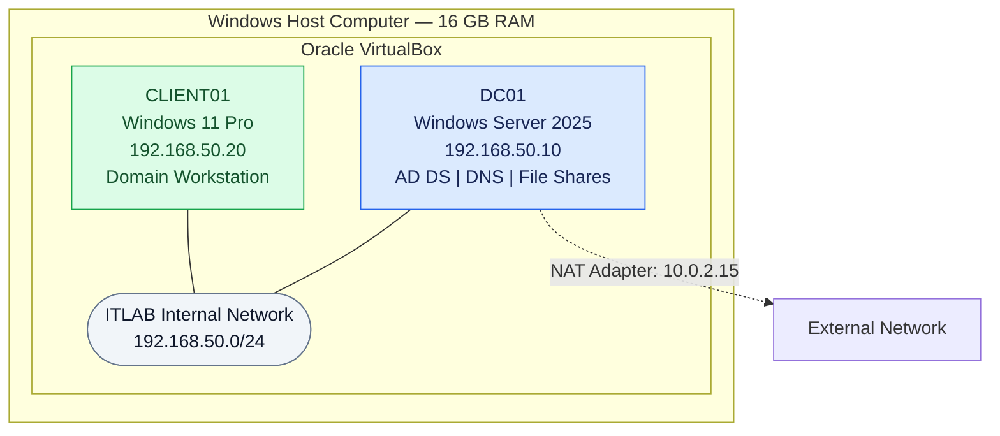

### Network Configuration

| Device | Operating System | IP Address | Role |
|---|---|---|---|
| DC01 | Windows Server 2025 | `192.168.50.10` | Domain Controller, DNS, File Shares |
| CLIENT01 | Windows 11 Pro | `192.168.50.20` | Domain Workstation |
| DC01 NAT | VirtualBox NAT Adapter | `10.0.2.15` | External network connectivity |

**Domain:** `corp.example.test`  
**NetBIOS Name:** `CORP`  
**Internal Network:** `ITLAB`  
**Subnet:** `192.168.50.0/24`

<details>
<summary><b>🖼️ View the Full Network Architecture Diagram</b></summary>


</details>

---

## 🛠️ What I Built

The following sections explain each part of the implementation. Expand any section to view the work completed and its supporting screenshots.

<details>
<summary><b>👥 01 — Active Directory & Employee Management</b></summary>

### What I Did

I installed Active Directory Domain Services on DC01 and created a new domain named `corp.example.test`.

To represent the business structure, I created a parent Organizational Unit called `AussieTech-Solutions` and separate OUs for each department.

The structure includes:

- Finance
- HR
- IT
- Management
- Operations
- Sales
- Security-Groups
- Servers
- Service-Accounts
- Workstations

I created 20 employee accounts and configured departmental security groups to support centralized user management.

### What I Learned

This helped me understand how Active Directory organizes users, computers, and security groups, and why OU structure matters when managing a business network.

### 📸 Evidence

**Active Directory Organizational Structure**

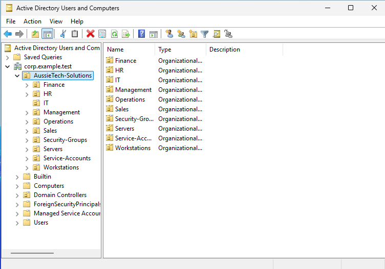

**IT Department Employee Accounts**

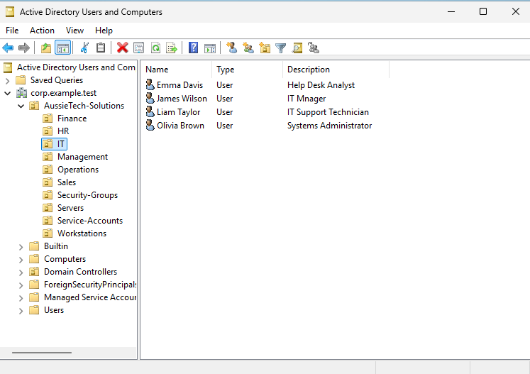

**HR Department Employee Accounts**

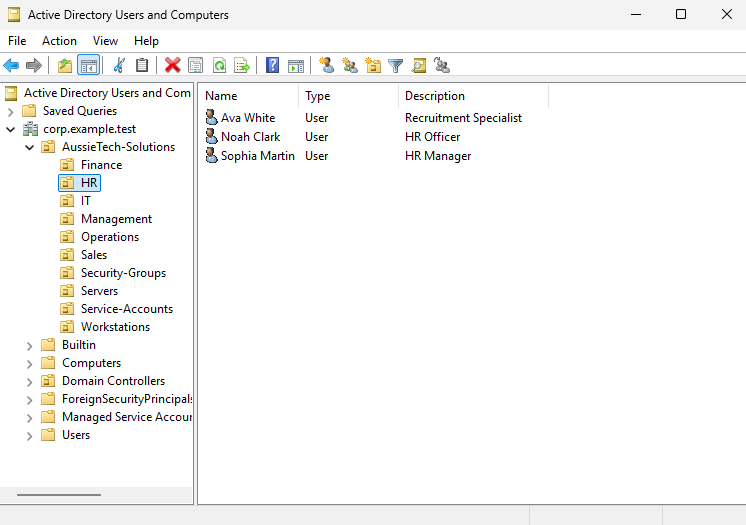

**Finance Department Employee Accounts**

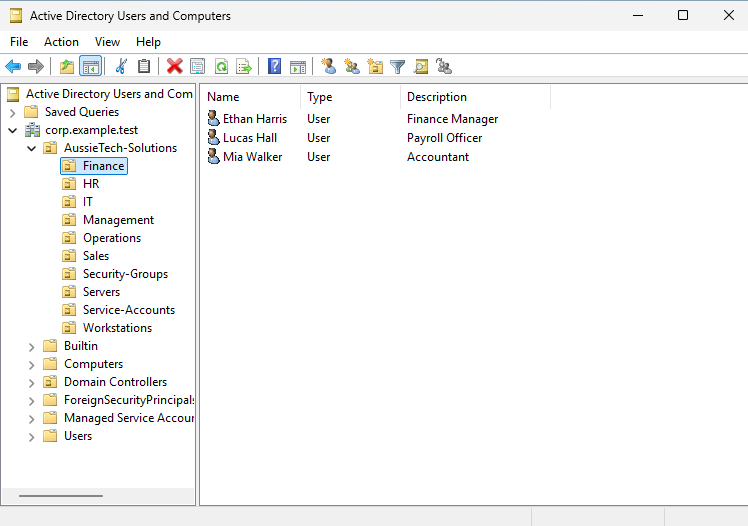

**Departmental Security Groups**

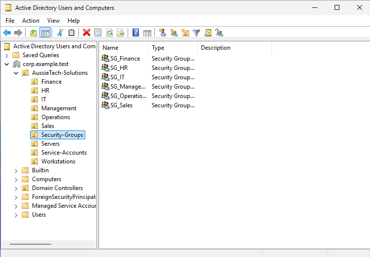

**Employee Account Properties**

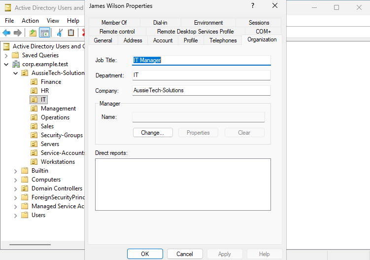

</details>

<details>
<summary><b>💻 02 — Windows 11 Deployment & Domain Integration</b></summary>

### What I Did

I deployed a Windows 11 Pro virtual machine named `CLIENT01` and configured its internal network settings.

The workstation was assigned:

- IPv4 address: `192.168.50.20`
- Subnet mask: `255.255.255.0`
- DNS server: `192.168.50.10`

After configuring the network, I joined CLIENT01 to `corp.example.test` and tested signing in with a domain employee account.

I also moved the CLIENT01 computer object into the Workstations OU so it could receive the intended Group Policy settings.

### What I Learned

This demonstrated the importance of correct DNS configuration when joining a Windows computer to an Active Directory domain.

### 📸 Evidence

**Domain Controller IP Configuration**

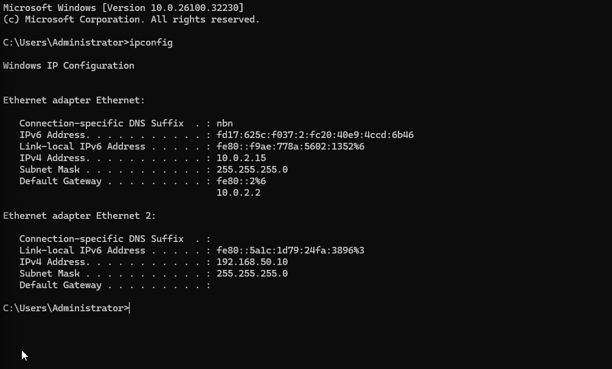

**Windows 11 Client IP Configuration**

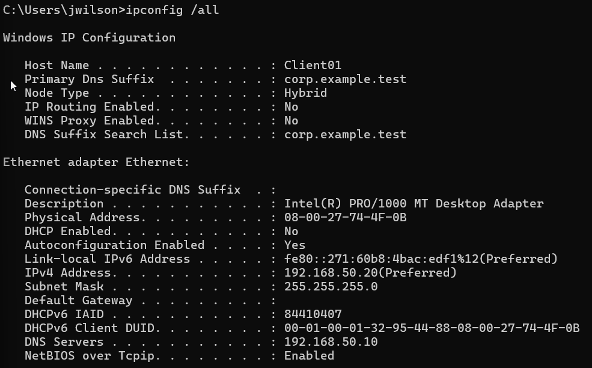

**CLIENT01 Domain Membership**

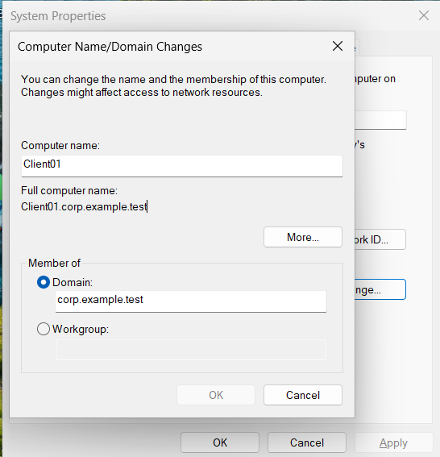

**CLIENT01 in the Workstations OU**

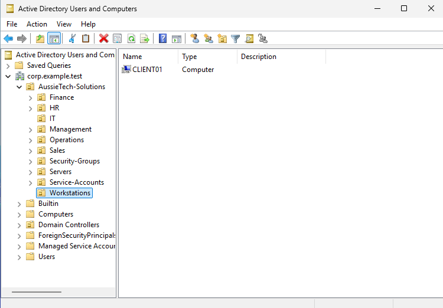

</details>

<details>
<summary><b>📁 03 — Departmental File Sharing & Access Control</b></summary>

### What I Did

I created shared folders for the company's departments and configured permissions to restrict access to authorized users.

The folders included Finance, HR, IT, Management, Operations, and Sales.

I then tested the permissions using an IT employee account.

**Test 1 — Authorized Access**

The employee successfully accessed:

`\\192.168.50.10\it`

**Test 2 — Restricted Access**

The same employee attempted to access:

`\\192.168.50.10\Finance`

Access was denied, demonstrating that departmental restrictions were working for the tested account.

### What I Learned

I gained practical experience with SMB file sharing, NTFS permissions, and the importance of limiting access to business resources.

### 📸 Evidence

**Departmental Shared Folders**

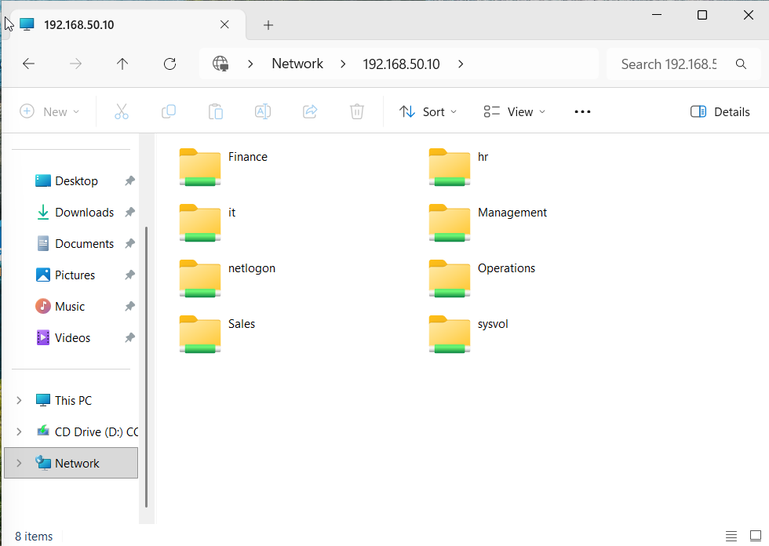

**IT Folder Security Permissions**

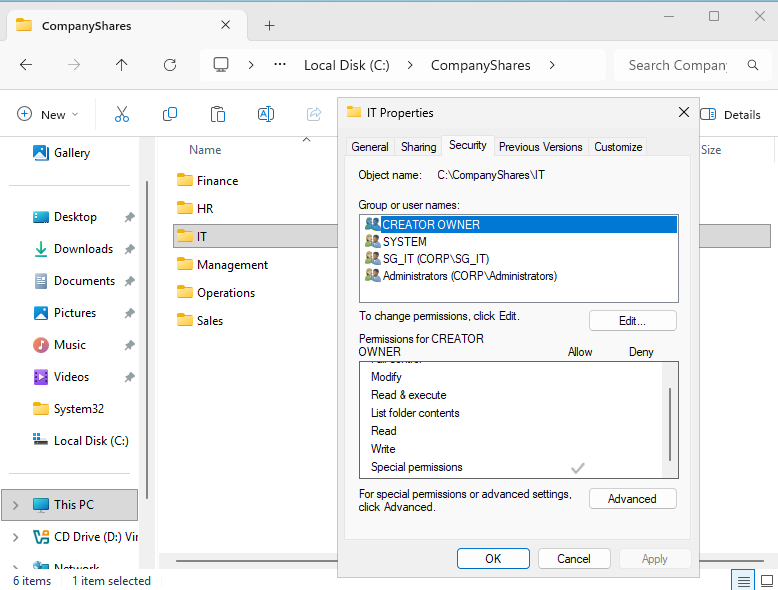

**Authorized IT Folder Access**

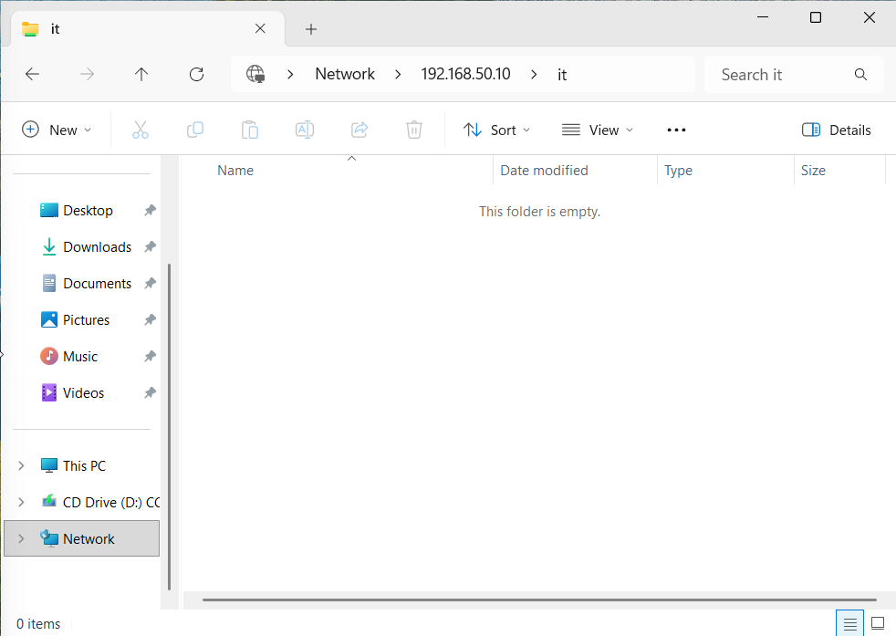

**Finance Folder Access Denied**

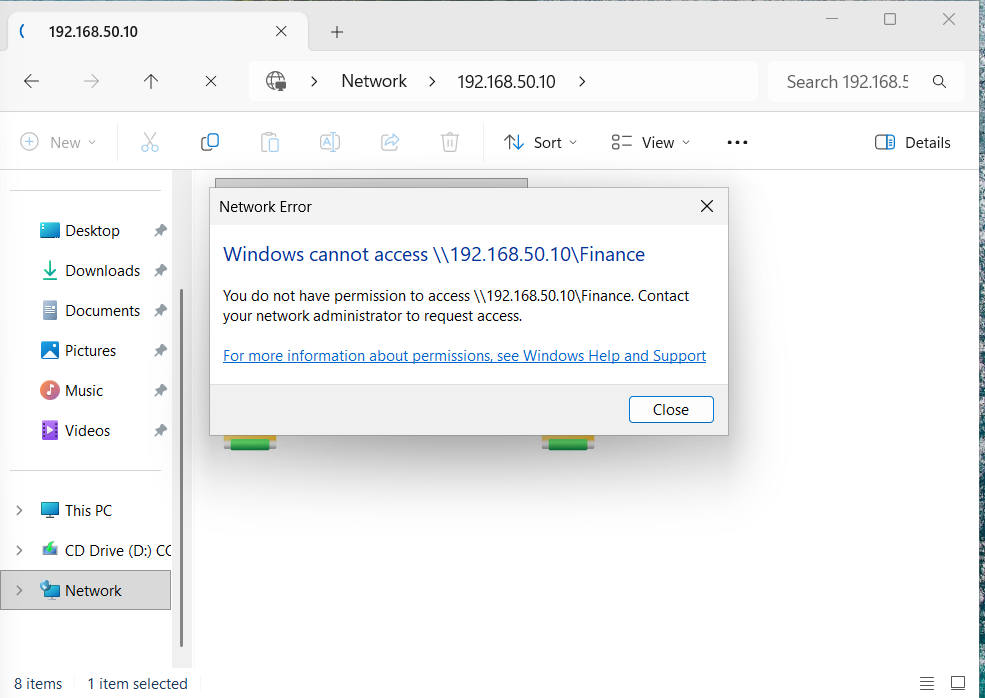

</details>

<details>
<summary><b>🔐 04 — Group Policy & Workstation Security</b></summary>

### What I Did

I created a Group Policy Object named:

`Employee Security Policy`

I linked the policy to the Workstations OU and configured the following setting:

**Interactive logon: Machine inactivity limit**

**Value:** `600 seconds`

This policy is intended to lock employee workstations after 10 minutes of inactivity.

I refreshed Group Policy and used the `gpresult` command to verify which computer policies were applied to CLIENT01.

I also tested the workstation's automatic locking behavior.

### What I Learned

This helped me understand how Group Policy links, Organizational Units, and computer objects work together.

### 📸 Evidence

**Employee Security Policy GPO**

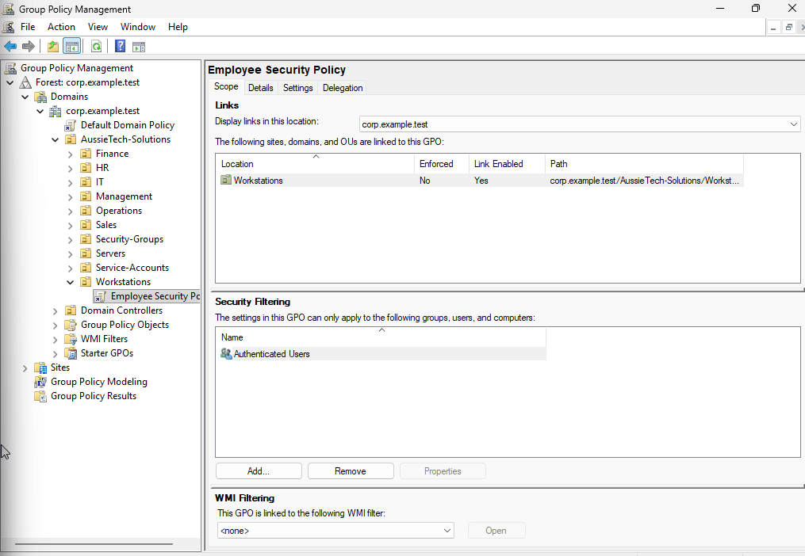

**10-Minute Inactivity Setting**

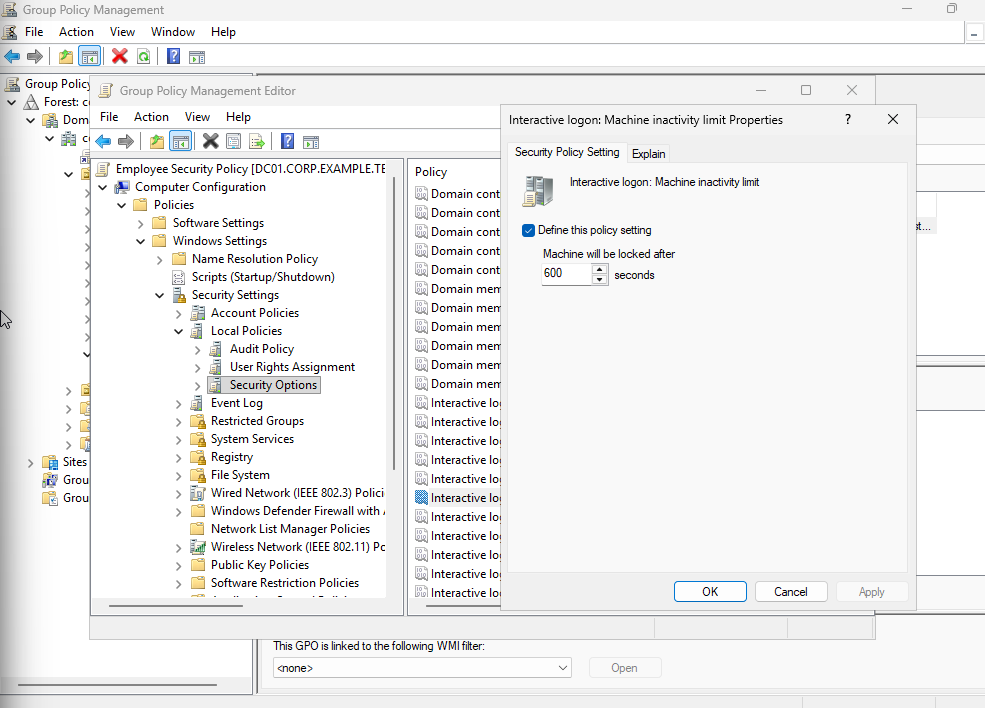

**Group Policy Application**

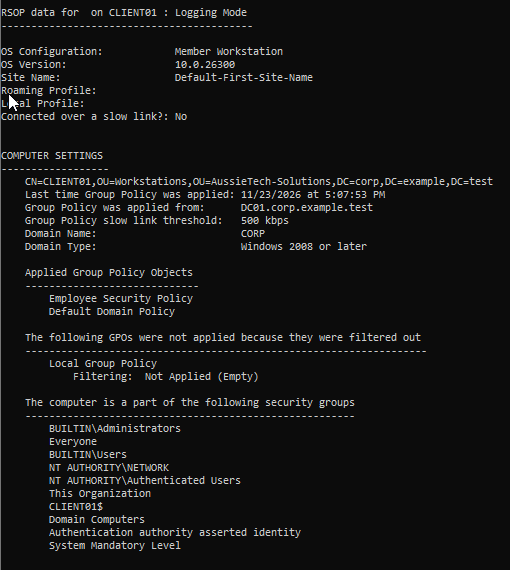

**Windows Workstation Lock Screen**

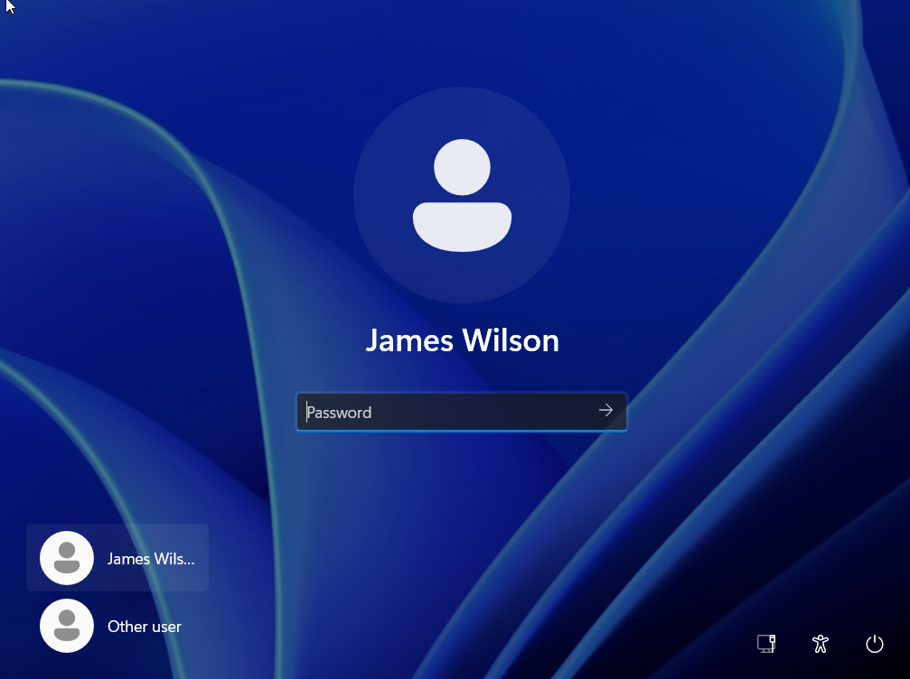

</details>

<details>
<summary><b>🛡️ 05 — Account Security & Help Desk Tasks</b></summary>

### What I Did

I configured the domain account lockout policy with these settings:

| Setting | Value |
|---|---|
| Failed login threshold | 5 attempts |
| Account lockout duration | 10 minutes |
| Reset lockout counter | 10 minutes |

I also practiced common service desk account-management tasks:

- Resetting an employee password in Active Directory
- Requiring a password change at the next sign-in
- Testing account lockout after incorrect login attempts
- Unlocking the employee account
- Confirming that the employee could sign in again

### What I Learned

These exercises helped me understand how account security settings affect employees and how IT support teams restore access safely.

### 📸 Evidence

**Account Lockout Policy**

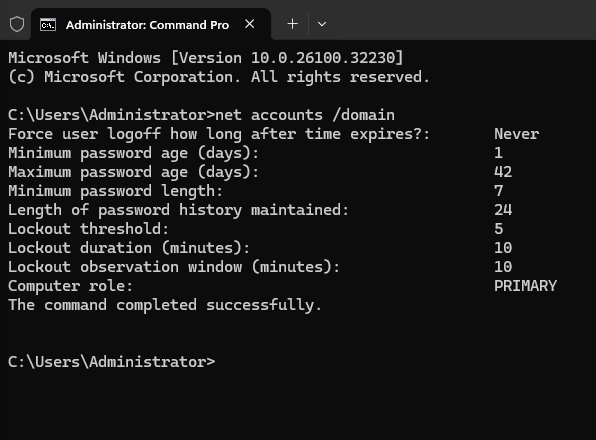

**Password Reset Interface**

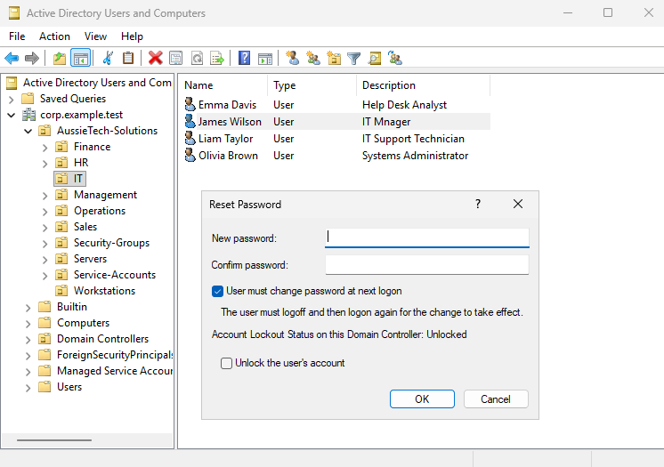

**Evidence Note:** The original screenshots of the password-change prompt and account lockout/unlock test were not retained. Those procedures are documented in the full report.

</details>

<details>
<summary><b>🌐 06 — Network & DNS Troubleshooting</b></summary>

### What I Did

I tested network connectivity between CLIENT01 and DC01 using `ping`.

I also tested DNS name resolution using `nslookup`.

During troubleshooting, I found that DC01's hostname had been registered with both its internal network address and its NAT adapter address.

The intended internal address was:

`192.168.50.10`

The unwanted NAT address was:

`10.0.2.15`

To address this, I reviewed the network adapter settings, disabled DNS registration on the NAT adapter, and removed the unwanted Host A record.

### What I Learned

This was one of the most useful parts of the project because I had to investigate an actual configuration issue instead of simply following setup instructions.

I learned why domain clients should use the correct internal DNS server and how multiple network adapters can complicate DNS registration.

### 📸 Evidence

**Network Connectivity**

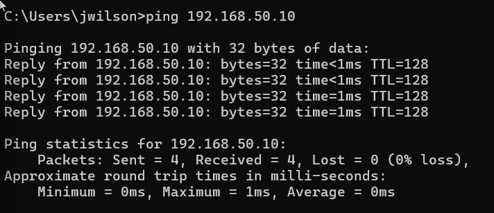

**DNS Name Resolution**

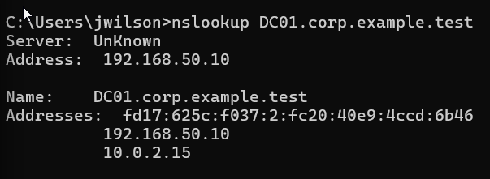

**DNS Diagnostic Results**

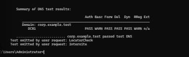

</details>

<details>
<summary><b>🖥️ 07 — Server Health Checks & VirtualBox Snapshots</b></summary>

### What I Did

I used Windows Server diagnostic commands to check Active Directory and DNS.

The commands included:

`dcdiag /q`

`dcdiag /test:dns /v`

The detailed DNS test reported an overall PASS with warnings in the Basic and Record Registration categories.

I also created VirtualBox snapshots for DC01 and CLIENT01 to preserve the completed lab environment.

### What I Learned

I gained experience using diagnostic tools, interpreting test results, and preserving a working lab before making further changes.

### 📸 Evidence

**Active Directory Diagnostic Output**

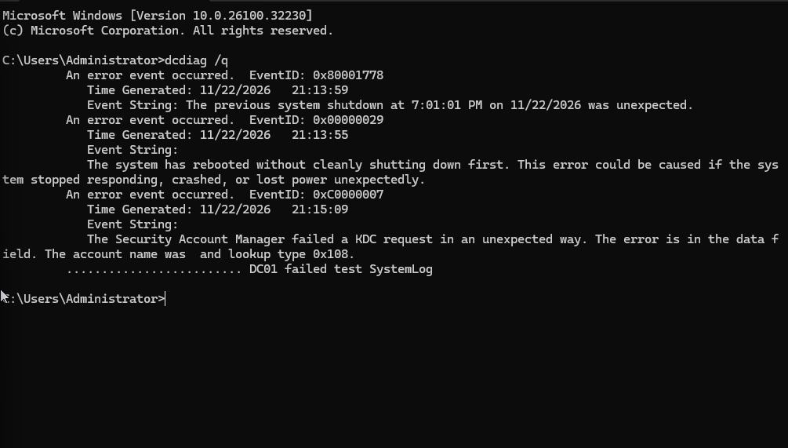

**VirtualBox VM Overview**

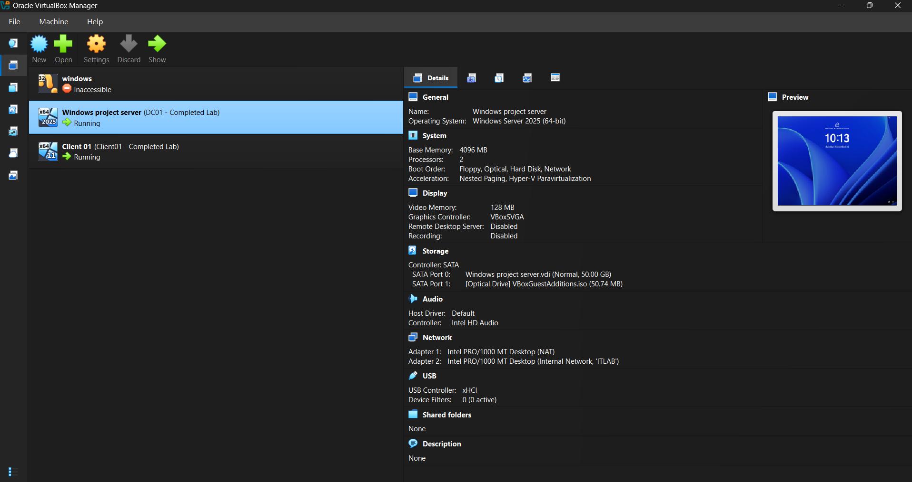

**VirtualBox Network Configuration**

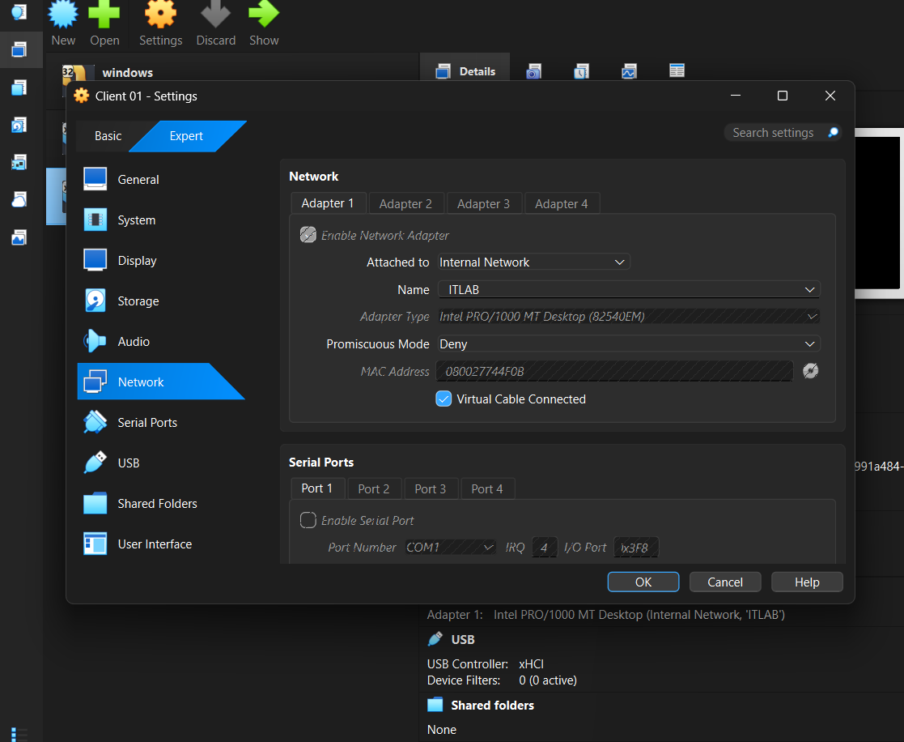

**DC01 Completed Lab Snapshot**

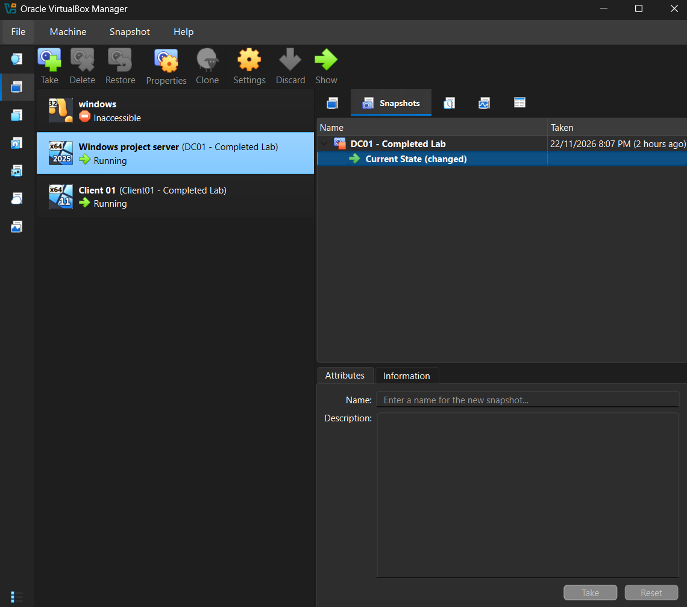

**CLIENT01 Completed Lab Snapshot**

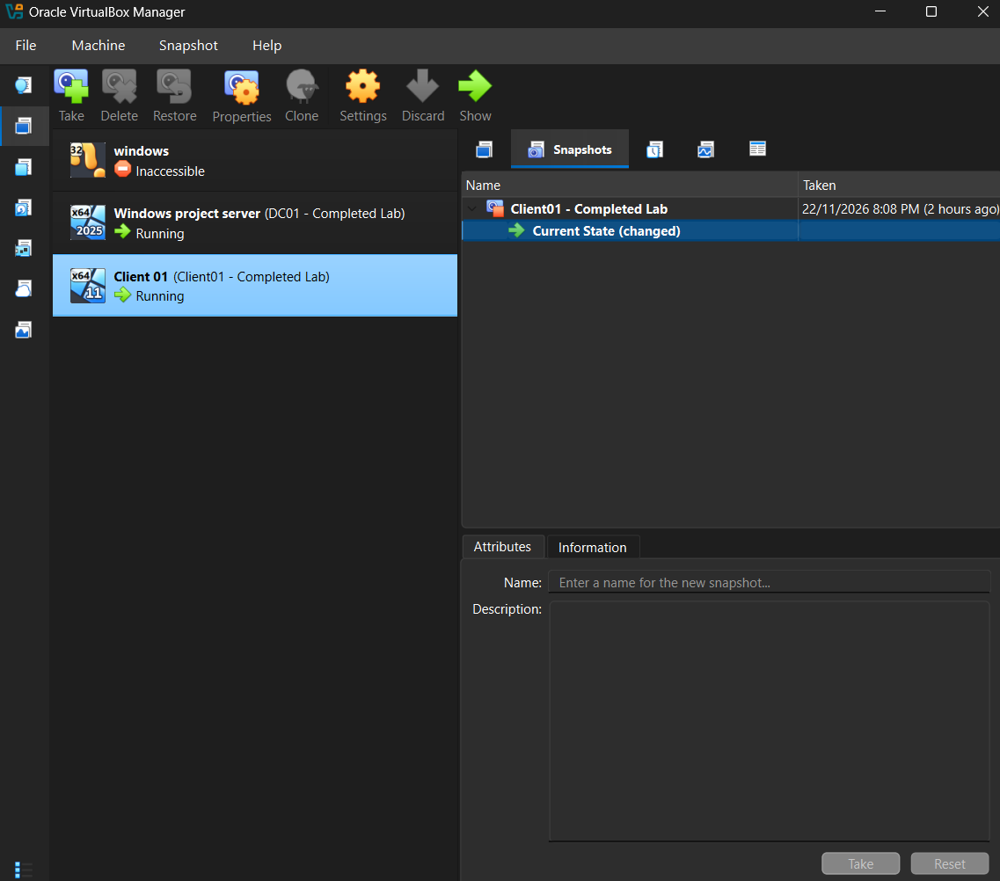

</details>

---

## 🔍 Troubleshooting & Lessons Learned

Setting up the infrastructure was only part of the project. I also encountered problems that required investigation.

### Issue 1 — CLIENT01 Could Not Reach DC01

**Problem:** A ping test from CLIENT01 to `192.168.50.10` failed.

**Investigation:** I checked the state of the domain controller and found that DC01 was powered off.

**Action:** I started DC01 and repeated the connectivity test.

**Lesson learned:** Before changing network settings, check the basics, including whether the target computer is running.

### Issue 2 — Incorrect DNS Registration

**Problem:** DC01's hostname was resolving to both its internal IP address and its NAT address.

**Investigation:** I reviewed DNS records and the network adapter configuration.

**Action:** I disabled DNS registration on the NAT adapter and removed the unwanted Host A record.

**Lesson learned:** Multi-homed servers need careful DNS configuration, especially when clients depend on DNS to locate domain services.

### Issue 3 — Group Policy Scope

**Problem:** The workstation needed to receive the security policy linked to the Workstations OU.

**Action:** I moved CLIENT01 into the correct OU, refreshed Group Policy, and checked the applied policies.

**Lesson learned:** Creating a GPO is not enough. Its link, scope, and the location of the computer object all matter.

### Issue 4 — Account Lockout Recovery

**Scenario:** An employee account became locked after repeated incorrect password attempts.

**Action:** I reviewed the account in Active Directory, unlocked it, and tested successful sign-in.

**Lesson learned:** Account security is not just about configuring restrictions. IT support teams also need to understand how to restore legitimate access.

---

## 🧪 Testing & Validation

I tested the main services and configurations after deployment.

| Test | Result |
|---|---|
| Active Directory domain authentication | ✅ Passed |
| Windows 11 domain membership | ✅ Passed |
| Employee login | ✅ Passed |
| IT shared folder access | ✅ Passed |
| Finance folder access restriction | ✅ Passed |
| Group Policy application | ✅ Passed |
| Automatic screen lock | ✅ Passed |
| Password reset and recovery | ✅ Passed |
| Account lockout and unlock | ✅ Passed |
| Internal DNS hostname resolution | ✅ Passed |
| Detailed DNS diagnostics | ⚠️ Passed with warnings |
| Active Directory SystemLog diagnostic | ⚠️ Requires follow-up verification |

### Known Issues

**DNS:** The detailed DNS diagnostic reported warnings in the Basic and Record Registration categories. These require further investigation before treating the environment as production-ready.

**Active Directory SystemLog:** A later diagnostic was reported to have identified a SystemLog failure associated with an unexpected shutdown. This result requires verification against the latest diagnostic output.

The lab's main functional tests were completed, but these diagnostic findings remain documented rather than being presented as fully resolved.

---

## ⌨️ Administration Commands

These are some of the commands I used during configuration, testing, and troubleshooting.

<details>
<summary><b>🌐 Network Configuration & Connectivity</b></summary>

```cmd
ipconfig
ipconfig /all
ping 192.168.50.10
```

**Purpose:** Review network settings and test communication between the client and domain controller.

</details>

<details>
<summary><b>🔎 DNS Troubleshooting</b></summary>

```cmd
nslookup corp.example.test
nslookup DC01.corp.example.test
dcdiag /test:dns /v
```

**Purpose:** Verify hostname resolution and investigate DNS diagnostic results.

</details>

<details>
<summary><b>🔐 Group Policy Verification</b></summary>

```cmd
gpupdate /force
gpresult /r /scope computer
```

**Purpose:** Refresh Group Policy and check which computer policies are applied.

</details>

<details>
<summary><b>👥 Account Security & Active Directory</b></summary>

```cmd
net accounts /domain
dcdiag /q
```

**Purpose:** Review domain account policies and perform domain controller diagnostic checks.

</details>

---

## 📂 Project Documentation

The repository contains the technical report, network diagram, and screenshots collected throughout the project.

```text
Windows-Server-2025-IT-Support-Lab/
│
├── README.md
│
├── Documentation/
│   └── AussieTech_WS2025_Project_Report.docx
│
├── Network-Diagram/
│   └── AussieTech-Network-Architecture.png
│
└── Screenshots/
    ├── 01-Active-Directory-Structure.png
    ├── 02-IT-Employee-Accounts.png
    ├── ...
    ├── 30-VirtualBox-Snapshots.png
    └── 31-CLIENT01-Completed-Snapshot.png
```

### 📄 Full Technical Report

[**Read the Windows Server 2025 Project Report**](Documentation/Windows-server-2025-IT-Support-Project_Report.pdf)

The report contains the implementation details, configuration tables, testing procedures, troubleshooting notes, and screenshot evidence index.

### 🗺️ Network Diagram

[**View the Network Architecture Diagram**](Network-Diagram/Network_Architecture_Diagram.png)

### 📷 Screenshots

[**Browse Project Screenshots**](Screenshots/)

---

## 🧠 Skills Developed

| Area | Practical Experience |
|---|---|
| Windows Server | Installation, configuration, and administration |
| Active Directory | Users, groups, OUs, and computer accounts |
| Identity Management | Authentication, password resets, account recovery |
| Networking | IP addressing, connectivity testing, DNS |
| Group Policy | Security policy creation, linking, and verification |
| File Sharing | SMB shares, NTFS permissions, access restrictions |
| Troubleshooting | Network, DNS, authentication, and policy issues |
| Virtualization | VirtualBox networking, VM management, snapshots |
| Documentation | Technical reports, diagrams, test evidence |

---

## 🚀 Future Improvements

I plan to expand the lab by introducing:

- A second domain controller to practice replication and redundancy
- A dedicated file server
- Additional Windows 11 workstations
- PowerShell automation for employee account management
- Centralized event monitoring
- Backup and recovery testing
- Further investigation of the remaining diagnostic warnings

These additions would allow me to explore more advanced Windows infrastructure and support scenarios.

---

## 📌 Project Status

**Core lab implementation completed — diagnostic follow-up items documented.**

This is a personal training and portfolio project based on a simulated business environment. It demonstrates practical Windows infrastructure administration and troubleshooting, not a production deployment.

The project helped me become more confident working with Windows Server, Active Directory, Group Policy, DNS, and common IT support tasks.

---

**Thanks for taking a look at my project!**
